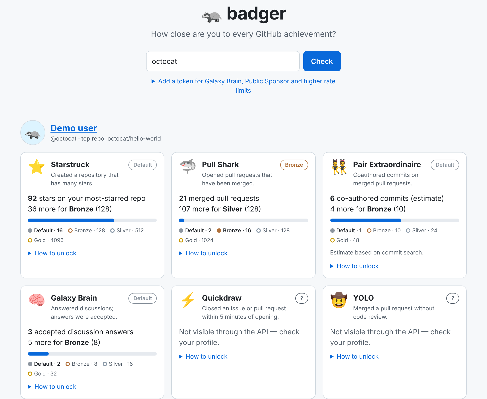

<h1 align="center">🦡 badger</h1>

<p align="center"><b>How close are you to every GitHub profile achievement?</b><br>
Type a username, see your tier for each achievement and exactly how many more you need for the next one.</p>

<p align="center">
  <a href="https://matthieum77.github.io/badger/"><b>▶ Try it live</b></a> ·
  <a href="https://matthieum77.github.io/badger/?demo=1">Demo</a> ·
  <a href="#how-to-unlock-each-achievement">Unlock guide</a>
</p>

<p align="center">
  <a href="https://github.com/MatthieuM77/badger/actions/workflows/ci.yml"></a>
  
  
</p>

<picture>
  <source media="(prefers-color-scheme: dark)" srcset="docs/screenshot-dark.png">
  
</picture>

## Why

GitHub shows an achievement once you unlock a tier, but not how far you are from the next one: is
Pull Shark Silver 5 PRs away or 100? badger reads your public activity and tells you.

- **Tier progress**: Default → Bronze → Silver → Gold, with a progress bar to the next tier.
- **Unlock guide**: every card explains how to earn the achievement the legitimate way.
- **Shareable**: `https://matthieum77.github.io/badger/?user=<login>`
- **Private by design**: runs entirely in your browser and talks only to `api.github.com`. No backend, no tracking, no dependencies.

## What's measured

| Achievement | Tiers | Measured from | Token needed |
|---|---|---|---|
| ⭐ Starstruck | 16 · 128 · 512 · 4096 | stars on your most-starred own repo | no |
| 🦈 Pull Shark | 2 · 16 · 128 · 1024 | merged PRs you authored | no |
| 👯 Pair Extraordinaire | 1 · 10 · 24 · 48 | co-authored commits (estimate) | no |
| 🧠 Galaxy Brain | 2 · 8 · 16 · 32 | accepted discussion answers | yes |
| 💖 Public Sponsor | 1 | accounts you sponsor | yes |
| ⚡ Quickdraw | 1 | not exposed by the API | – |
| 🤠 YOLO | 1 | not exposed by the API | – |

The token is optional. A [fine-grained token](https://github.com/settings/personal-access-tokens/new) with **no permissions** is enough (public data only); it stays in your browser tab's `sessionStorage`.

Numbers come from the public API and can differ slightly from GitHub's internal count. GitHub
can also take a few hours to award an achievement.

## How to unlock each achievement

- **⚡ Quickdraw**: open an issue in your own repo and close it within 5 minutes.
- **🤠 YOLO**: merge a pull request without a review.
- **🦈 Pull Shark**: get pull requests merged. Fixing a typo in docs you read is a great start.
- **👯 Pair Extraordinaire**: add `Co-authored-by: Name <email>` to a commit made with a friend, then merge the PR.
- **🧠 Galaxy Brain**: answer questions in repositories' Discussions tab; the asker must accept your answer.
- **⭐ Starstruck**: build something useful and share it. Stars must come from real people.
- **💖 Public Sponsor**: sponsor a maintainer you rely on via [GitHub Sponsors](https://github.com/sponsors).

> ⚠️ Fake stars, sock-puppet accounts or spam PRs on other people's repositories break
> [GitHub's Acceptable Use Policies](https://docs.github.com/en/site-policy/acceptable-use-policies/github-acceptable-use-policies)
> and can get your account suspended. badger is a progress tracker, not a cheat.

## Run locally

```bash
git clone https://github.com/MatthieuM77/badger.git && cd badger
npm start   # serves the folder on http://localhost:3000
npm test    # 14 tests, built-in Node test runner
```

Project layout: `src/achievements.js` (catalogue and tier maths), `src/github.js` (API client),
`src/app.js` (UI), `style.css`.

## Contributing

Issues and PRs welcome, especially if GitHub adds or changes an achievement. Tier thresholds live
in [`src/achievements.js`](src/achievements.js).

## 🇫🇷 En français

badger affiche, pour n'importe quel compte GitHub, le palier atteint pour chaque succès du profil
(Starstruck, Pull Shark, Pair Extraordinaire…) et ce qu'il reste à faire pour le suivant.
Tout tourne dans le navigateur. [Essayer en ligne →](https://matthieum77.github.io/badger/)

## License

[MIT](LICENSE)
